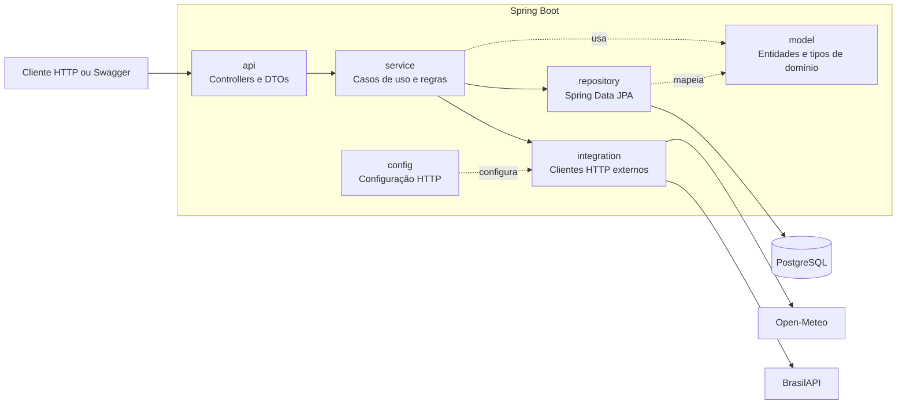

# Motor de Recomendação Fruki

API REST do MVP de recomendação de produtos. O motor combina histórico de compras, produtos complementares, promoções, estoque, clima, feriados e multiplicador regional para gerar uma lista curta e explicável por cliente.

## Arquitetura resumida



**Fluxo de recomendação:** `RecomendacaoController` recebe o GET e chama `MotorRecomendacaoService`. O motor lê cliente, histórico, catálogo com estoque e promoções pelos repositórios; consulta o contexto por `ContextoRecomendacaoService`; calcula score com `PontuadorRecomendacao` e `PontuadorContextual`; então transforma o resultado em DTO.

**Fluxo de cross-sell:** o cadastro de pedido ou o endpoint administrativo aciona `CrossSellService`, que lê os itens dos pedidos, calcula pares e atualiza as associações em `produto_complementar`.

**Responsabilidade dos pacotes:** `api` expõe HTTP; `service` concentra os casos de uso; `repository` consulta e persiste dados; `model` mapeia entidades e tipos; `integration` acessa Open-Meteo e BrasilAPI; `config` configura os clientes HTTP. Notificações têm entidade e repositório para persistência, mas ainda não têm fluxo de envio ou endpoint.

## Tecnologias e pré-requisitos

- Java 21
- Spring Boot, Spring Web, Spring Data JPA e Hibernate
- PostgreSQL e Flyway
- Maven Wrapper
- JUnit Jupiter e Mockito para testes unitários
- Acesso à internet para consultar clima e feriados

## Executar o MVP

### 1. Obter o projeto e configurar o banco

```powershell
git clone https://github.com/vvini-afk/Desafio_GC26.git
cd Desafio_GC26
```

Configure uma instância PostgreSQL acessível à aplicação. No PowerShell, defina as configurações localmente antes de iniciar:

```powershell
$env:SPRING_DATASOURCE_URL = "jdbc:postgresql://<host>:5432/<database>"
$env:SPRING_DATASOURCE_USERNAME = "<usuario>"
$env:SPRING_DATASOURCE_PASSWORD = "<senha>"
```

### 2. Inicializar o schema

O Flyway roda na inicialização. Em um schema vazio, a migration V1 cria as tabelas do MVP e a V2 adiciona `regiao` e `multiplicador` à tabela `cidade`. Em um banco existente, o Flyway registra o baseline conforme a configuração do projeto e executa as migrations posteriores. O usuário do banco precisa poder criar e atualizar `flyway_schema_history` e aplicar migrations.

O Hibernate está em modo `validate`: ele verifica o mapeamento, mas não cria nem altera tabelas. A view `public.vw_clientes_quebra_consumo` deve existir no banco e expor `id_cliente`; sua definição depende do schema e da regra de negócio adotados pelo ambiente.

Para obter recomendações, o banco também precisa conter clientes, produtos e saldos em `estoque_erp`. O schema vazio criado pela V1 não inclui dados de catálogo. Apenas produtos ativos com saldo maior que zero são elegíveis. Para usar o multiplicador regional, preencha `cidade.regiao` e `cidade.multiplicador`.

### 3. Iniciar a aplicação

Windows PowerShell:

```powershell
.\mvnw.cmd spring-boot:run
```

Linux/macOS:

```bash
./mvnw spring-boot:run
```

A API fica em `http://localhost:8080`. A documentação interativa fica em `http://localhost:8080/swagger-ui.html`.

Para rodar os testes unitários:

```powershell
.\mvnw.cmd test
```

### 4. Fazer uma chamada de recomendação

Use um `clienteId` existente no banco. Se o cliente não tiver cidade cadastrada, passe uma cidade para habilitar o contexto climático:

```http
GET http://localhost:8080/api/recomendacoes/1?cidade=Porto%20Alegre&limite=10
```

A API retorna até 10 recomendações. O parâmetro `limite` aceita valores de 1 a 100. Se não houver produto com motivo válido para recomendar, a resposta será `[]`.

## Endpoints principais

| Método | Endpoint | Uso |
|---|---|---|
| `GET` | `/api/clientes` | Lista clientes cadastrados. |
| `POST` | `/api/clientes` | Cadastra cliente. Use `cidadeId` ou `cidade` se a cidade já estiver na tabela `cidade`. |
| `POST` | `/api/produtos` | Cadastra produto e possíveis relações de complementaridade. |
| `POST` | `/api/pedidos` | Registra pedido e itens; também atualiza as associações de cross-sell. |
| `POST` | `/api/promocoes` | Cadastra promoção por produto ou família. Tipos: `PERCENTUAL` e `VALOR_FIXO`. |
| `GET` | `/api/recomendacoes/{clienteId}` | Retorna as recomendações ordenadas pelo score. Aceita `cidade` e `limite`. |
| `GET` | `/api/recomendacoes/{clienteId}/diagnostico` | Mostra score e motivos, cidade/região, multiplicador e contagem de recompra, itens inéditos e cross-sell. |
| `POST` | `/api/admin/processar-cross-sell` | Recalcula as associações a partir dos pedidos existentes. |

Todos os `POST` recebem `Content-Type: application/json`. Exemplo de cliente:

```http
POST http://localhost:8080/api/clientes
Content-Type: application/json
```

```json
{
  "nome": "Cliente de Teste",
  "perfil": "Varejo",
  "subsegmento": "Mercado"
}
```

A resposta contém o ID gerado; use-o em `/api/recomendacoes/{clienteId}`. Para um cliente novo sem histórico, promoções ou contexto relevante, é esperado que a lista fique vazia.

## Lógica da recomendação

Cada candidato elegível começa com score 10. Esse valor-base, sozinho, não é motivo: produtos sem nenhum fator aplicável são removidos antes de ordenar e responder.

| Fator | Pontuação/regra |
|---|---|
| Recompra direta | `+5` se o ID exato do produto está no histórico. |
| Afinidade de família | `+3` por item anterior da mesma família, até `+10`; aplica-se apenas a produtos ainda não comprados. |
| Cross-sell inédito | `+20` se o produto ainda não foi comprado e complementa um item do histórico em `produto_complementar`. |
| Promoção vigente | `+15`; promoção específica do produto tem prioridade sobre promoção por família. |
| Clima | Calor: `+8`; frio: `+10`; chuva: `+6`, conforme temperatura, precipitação/código WMO e famílias configuradas. |
| Feriado próximo | `+7` para famílias configuradas durante a janela de feriado. |
| Região | Multiplica o score final pelo `cidade.multiplicador`. Se ausente ou inválido, usa `1`. |

As famílias climáticas seguem os códigos `produto.cod_familia` do catálogo Fruki. Frio contempla `0117 - VINHO VIDRO`, `0105 - CITRUS` e `0109 - SUCOS`; chuva contempla `0101 - REFRIGERANTE PET`, `0109 - SUCOS` e `0117 - VINHO VIDRO`. Essas associações são hipóteses comerciais, não resultados estatísticos de vendas. Os motivos do DTO explicam os fatores aplicados; `jaComprado`, `isCrossSell` e `pilares` identificam os pilares na resposta.

O cross-sell calcula pares de itens que aparecem juntos em pedidos e mantém até três complementares ativos por produto. O endpoint administrativo permite recalcular as associações já existentes.

## Persistência e integrações

O projeto mapeia `cliente`, `cidade`, `hierarquia`, `produto`, `estoque_erp`, `pedido`, `item_pedido`, `produto_complementar`, `promocao` e `notificacao`. Os itens de pedido usam a chave composta `(pedido_id, produto_id)`. A entidade `Notificacao` e seu repositório permitem persistir mensagens do tipo `RECUPERACAO`; a consulta de clientes em quebra de consumo lê `vw_clientes_quebra_consumo`.

- **Open-Meteo:** geocodifica cidade e fornece clima atual; não requer chave da aplicação.
- **BrasilAPI:** fornece feriados; não requer chave da aplicação.
- **Flyway:** migrations em `src/main/resources/db/migration`; migrations já aplicadas não devem ser editadas.

## Limitações conhecidas

- O scoring usa regras e pesos fixos; eles precisam ser avaliados com dados reais de vendas.
- A associação de frio e chuva a famílias de produto é uma hipótese comercial.
- O multiplicador depende dos valores mantidos na tabela `cidade`; valores ausentes usam fator neutro `1`.
- O filtro de estoque depende da atualização de `estoque_erp`; o motor não reserva nem sincroniza saldo com o ERP.
- A view `vw_clientes_quebra_consumo` precisa ser criada e mantida pelo banco; o repositório espera a coluna `id_cliente`.
- A persistência de notificações está mapeada, mas ainda não há endpoint de geração ou envio de mensagens.
- A API não implementa autenticação/autorização nem paginação da lista de clientes.
- Indisponibilidade das APIs externas remove somente o fator de clima/feriado; os fatores internos continuam sendo calculados.
